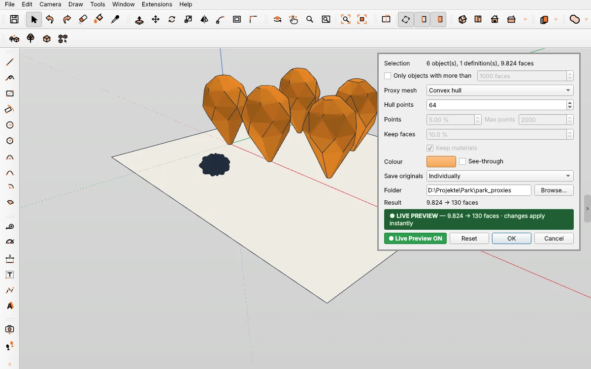

# Proxies — light stand-ins for heavy objects in IngeTrazo

Replace heavy objects (imported trees, furniture, cars) by light proxy meshes and keep the full geometry on disk as .igz files. The document gets small and the viewport fast; before a render or an export the originals come back with one click. The workflow follows Q-Proxies for 3ds Max.

## Install
Download `proxy_tool.py` from the [latest release](../../releases/latest), copy it into the plugins folder (Extensions ▸ Open plugins folder; on Windows `%APPDATA%\ingetrazo\plugins`) and restart IngeTrazo. Needs IngeTrazo ≥ 0.5.7 · tested with IngeTrazo 0.5.8.

You find it under **Extensions ▸ Proxies**, in the right-click menu and in the «Proxies» toolbar (4 icons).

## Commands
- **Create Proxies…** — turn the selected groups or components into proxies.
- **Show Originals** — load the full geometry back (the selected proxies, or all when nothing is selected). Use it before Render with Blender or an export.
- **Show Proxies** — back to proxies. An original edited meanwhile is written to its .igz again.
- **Select All Proxies** — select every proxy in the document.

Name, placement, layer, the group's material and instances are kept; copies of a component share one proxy, exactly as they share one definition. A proxy whose original is shown can be made a proxy again with another type or other settings. One undo step per command.

## Create Proxies…
| Field | Meaning |
|---|---|
| Only objects with more than … faces | Filter: small objects stay as they are |
| Proxy mesh | **Box** (bounding box in the object's own axes) · **Convex hull** · **Vertex cloud** · **From source** (the original reduced) |
| Hull points | Extreme points the convex hull goes through |
| Points / Max points | Share of the vertices shown as small crosses |
| Keep faces / Keep materials | Reduction of the original (vertex clustering), keeping its materials |
| Colour / See-through | Proxy colour, see-through at 35 % |
| Save originals | **Individually** (one .igz per object) · **All together** (proxies.igz) · **By layer** (one .igz per layer) |
| Folder | Default: `<document>_proxies` next to the .igz |

**Preview** (as in every PESI3D plugin): the green «● Live Preview ON» shows the proxies in the model and follows every change; **OK** keeps the preview as it is, **Cancel** takes it back, **Reset** restores the defaults. The dialog is non-modal — orbit, pan and zoom while it is open.

Every original .igz opens in IngeTrazo as a normal document. Its path is stored relative to the document, so the project folder can be moved as a whole.

## Changelog
- **1.0** — first release: Create Proxies… (box, convex hull, vertex cloud, from source), originals saved as .igz, Show Originals / Show Proxies, one proxy per component, Live Preview, own toolbar. Tested with IngeTrazo 0.5.8.

## Note
Not affiliated with Spline Dynamics or Autodesk; «Q-Proxies» and «3ds Max» are named only to describe the workflow.

License GPL-3.0-or-later · Pesi, [pesi3d.de](https://pesi3d.de) — German: [LIESMICH.md](LIESMICH.md)
